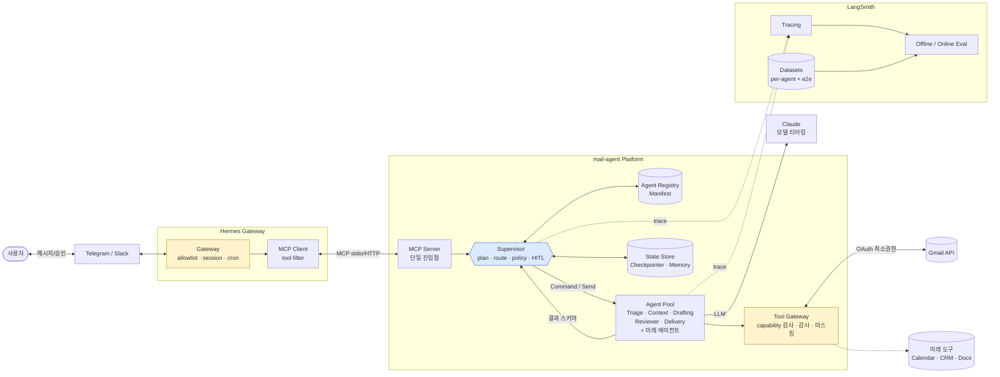
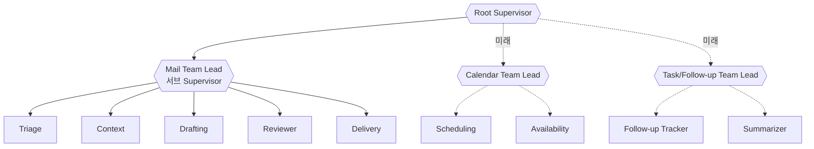
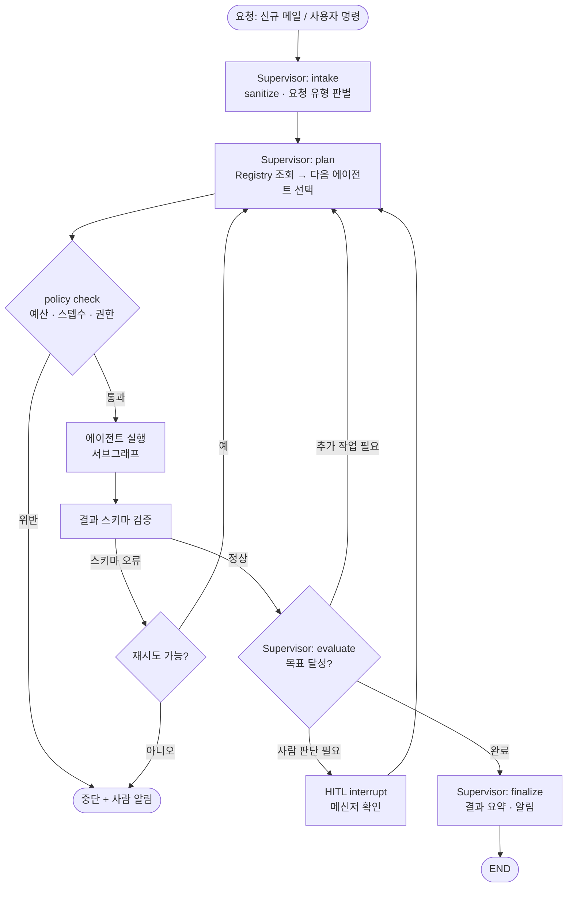
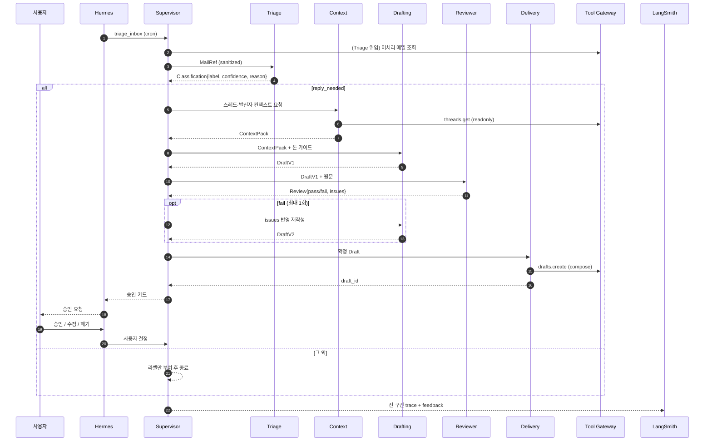

# PRD — Mail Agent Platform (Supervisor + Multi-Agent)

작성일: 2026-10-24 · 상태: v0.3 (4단계 구축 반영) (싱글 에이전트 → 감독자 기반 멀티 에이전트로 재설계)

## 1. 목표
수신 이메일 중 **회신이 필요한 메일을 분류**하고 **회신 초안을 생성**한다. 단, 이를 단일 에이전트가 아닌 **Supervisor가 전문 에이전트들을 감독·조율하는 구조**로 구축해, 이후 일정·후속조치·요약 등 **새 에이전트를 코드 변경 최소로 추가**할 수 있는 플랫폼을 만든다.

초안은 Gmail 초안함에만 저장하며 **자동 발송하지 않는다**.

### 설계 원칙
1. **Supervisor는 판단만, 실행은 안 한다** — 도구 권한이 없고, 계획·라우팅·종료 판단·정책 집행만 담당.
2. **에이전트 = 플러그인** — Manifest 등록만으로 Supervisor가 발견·라우팅 (Agent Registry).
3. **도구는 Tool Gateway 단일 관문** — 에이전트별 capability 범위만 허용, 감사·마스킹 일괄 적용.
4. **계약 기반 통신** — 에이전트 간 입출력은 Pydantic 스키마, 자유 텍스트 전달 금지(인젝션 전파 차단).
5. **관측 가능성 내장** — 에이전트·Supervisor 결정마다 LangSmith span + 에이전트 단위 Eval.

### 성공 지표 (MVP)
| 지표 | 목표 |
|---|---|
| 회신필요 분류 Recall / Precision | ≥ 95% / ≥ 80% |
| 초안 채택률 (수정 ≤ 20%) | ≥ 60% |
| Supervisor 라우팅 정확도 | ≥ 95% |
| 무승인 발송 사고 | 0건 (구조적 불가) |
| 신규 에이전트 추가 소요 | 신규 코드 모듈 1개 + Manifest 1개, Supervisor/그래프 코어 수정 0 |
| 메일 1건 p95 지연 | ≤ 25s |

## 2. 범위
**In (MVP)**: Gmail 읽기, Supervisor, MVP 에이전트 5종, Registry/Tool Gateway, 메신저 승인 루프, LangSmith 평가·트레이싱.
**Out (MVP)**: 자동 발송, 첨부파일 분석, 다계정, 원격(외부 호스팅) 에이전트 실제 연동 — 단 *확장 지점은 설계에 포함*.

## 3. 아키텍처

### 3.1 시스템 구성도

노란색 = 보안 경계, 파란색 = 감독 계층.

### 3.2 계층 구조 (확장 모델)

- MVP는 `Root Supervisor → Mail Team Lead → 에이전트 5종` 2단계. Root는 도메인(팀) 단위로만 라우팅하고, 팀 리드가 팀 내부를 조율한다. 새 도메인은 팀을 추가해 붙인다 (LangGraph 서브그래프 중첩).
- 점선은 미래 확장이며 MVP에서는 구현하지 않는다.

### 3.3 Supervisor 처리 흐름


### 3.4 메일 회신 시나리오 (MVP 정상 경로)


## 4. 에이전트 설계

### 4.1 에이전트 계약 (Manifest)
모든 에이전트는 아래 Manifest를 `agents/<name>/manifest.yaml`로 선언한다. Registry가 부팅 시 로드·검증한다.

```yaml
name: drafting
team: mail
description: 컨텍스트를 바탕으로 회신 초안을 작성/수정한다   # Supervisor 라우팅 근거
input_schema: DraftRequest      # Pydantic
output_schema: DraftResult
model_tier: standard            # light | standard | strong → 모델 매핑은 설정으로
capabilities: []                # Tool Gateway 허용 목록 (이 에이전트는 도구 없음)
risk_tier: low                  # low | medium | high (high = 항상 HITL)
limits: {max_steps: 3, max_tokens: 4000, timeout_s: 30}
eval: {dataset: drafting-v1, evaluators: [tone, hallucination, language_match]}
```

### 4.2 MVP 에이전트
| 에이전트 | 책임 | 모델 티어 | capabilities | risk |
|---|---|---|---|---|
| **Triage** | 회신필요/FYI/뉴스레터/스팸 분류, 신뢰도·사유 | light (Haiku) | 없음 (입력만 받음) | low |
| **Context** | 스레드·발신자 이력 수집·요약 | light | `gmail.read` | low |
| **Drafting** | 초안 작성·수정, 원문 언어/톤 매칭 | standard (Sonnet) | 없음 | low |
| **Reviewer** | 환각·과도한 약속·인젝션 흔적 점검, 통과/실패 | standard | 없음 | low |
| **Delivery** | Gmail 초안 저장, 메신저 카드 생성 | 모델 불필요(결정적) | `gmail.draft.create`, `notify` | medium |

LLM 에이전트는 도구를 직접 갖지 않고, 도구 호출이 필요한 에이전트(Context, Delivery)만 Tool Gateway를 통한다.

### 4.3 Supervisor 책임
| 기능 | 내용 |
|---|---|
| Plan/Route | Registry의 description·스키마로 다음 에이전트 선택 (structured output). MVP는 규칙 우선 + LLM 폴백 |
| Policy | 최대 스텝·토큰·시간 예산, risk_tier별 HITL 강제, 동일 에이전트 재시도 한도 |
| Validation | 에이전트 출력 스키마 검증, 실패 시 재시도/에스컬레이션 |
| HITL | `interrupt()`로 사용자 승인·수정 지시 수신, 해당 에이전트로 재투입 |
| Memory | thread 단위 checkpointer + 사용자 선호(톤·서명) 장기 메모리 |
| Finalize | 결과 요약 → Hermes 응답 |

### 4.4 미래 에이전트 확장 로드맵 (참고)
| 후보 | 목적 | 필요 capability |
|---|---|---|
| Scheduling | 미팅 요청 메일 → 가능 시간 제안 | `calendar.read` |
| Follow-up Tracker | 회신 대기·리마인드 | `gmail.read`, 스토리지 |
| Summarizer | 긴 스레드/일일 다이제스트 | `gmail.read` |
| Knowledge/RAG | 사내 문서 기반 답변 근거 | `docs.read` |
| Translator | 다국어 회신 | 없음 |
| Remote Agent | 외부 호스팅 에이전트 (A2A/MCP 어댑터) | 어댑터 단위 |

**확장 절차**: ① 스키마·Manifest 작성 → ② 에이전트 서브그래프 구현 → ③ capability 허용 등록(보안 리뷰) → ④ 에이전트별 데이터셋·evaluator 추가 → ⑤ Registry 재시작. Supervisor·코어 그래프 코드 수정 없음이 목표.

## 5. State & 통신 계약
- **Root State**: `request`, `plan`(steps, budget), `artifacts`(에이전트 산출물 맵), `trace_meta`, `approval`.
- 에이전트는 자신의 **private state**를 가지며, Supervisor와는 **입출력 스키마로만** 교환 (LangGraph 서브그래프 + 상태 변환).
- 에이전트 간 직접 호출 금지. 모든 전달은 Supervisor 경유 (감사·정책 일원화).
- 메일 본문 등 비신뢰 데이터는 `untrusted: true` 필드로 표기, 에이전트 시스템 프롬프트에서 *데이터*로만 취급.

## 6. 보안 요구사항
1. **최소 권한 OAuth**: `gmail.readonly` + `gmail.compose`. `gmail.send`/`modify` 미요청, 발송 도구는 코드에 존재하지 않음.
2. **Tool Gateway(capability-based)**: 에이전트→capability 매핑을 Manifest에서만 선언, 런타임에 호출자 에이전트 ID로 검증. 미허용 호출은 거부+경보.
3. **Supervisor 무도구 원칙**: Supervisor는 직접 외부 도구를 호출하지 못함 → 인젝션이 Supervisor를 장악해도 영향 제한.
4. **프롬프트 인젝션 방어**: sanitize, 스키마 기반 전달(자유 텍스트 체인 차단), Reviewer 점검, 도구 권한 분리.
5. **시크릿 관리**: `.env`/OS 키체인, git 제외, 트레이스 시크릿 마스킹.
6. **PII/트레이스 정책**: LangSmith 업로드 전 마스킹 훅. 평가 데이터는 합성 우선.
7. **게이트웨이 접근제어**: Hermes allowlist 필수(기본 deny), MCP tool filter로 진입점 도구만 노출.
8. **에이전트 등록 거버넌스**: 신규 Manifest는 capability 변경 시 리뷰 필수(CODEOWNERS), 서명/해시 검증은 원격 에이전트 도입 시 필수.
9. **예산·루프 방지**: 스텝/토큰/시간 상한, 초과 시 중단 후 사람 알림.
10. **감사 로그**: Supervisor 결정, 도구 호출, 승인·폐기 전부 기록.

## 7. LLMOps (LangSmith)
평가를 **3계층**으로 구성한다.

| 계층 | 대상 | 방법 |
|---|---|---|
| Unit (에이전트별) | Triage, Drafting, Reviewer … | 에이전트별 데이터셋 + evaluator. Triage: Recall/Precision, Drafting: LLM-judge(정확성·톤·언어·환각), Reviewer: 결함 주입 탐지율 |
| Orchestration | Supervisor | 라우팅 정확도, 불필요 스텝/루프, 예산 준수, **trajectory 평가**(기대 호출 순서 대비) |
| End-to-end | 전체 | 합성 메일함 시나리오 → 최종 초안 품질, 지연, 비용, 안전(인젝션 내성) |

- **Tracing**: Supervisor span 아래 에이전트 서브그래프 중첩. 메타데이터: `agent`, `team`, `model_tier`, `risk_tier`, 비용.
- **신규 에이전트 온보딩 게이트**: 에이전트별 데이터셋·evaluator 없이는 Registry 활성화 불가(CI 체크).
- **Online**: 승인/수정/폐기 피드백 → 실패 사례를 해당 에이전트 데이터셋으로 환류.
- **진단 시연 시나리오**
  1. Triage 프롬프트 약화 → e2e 품질 하락 → 계층 평가로 *Triage가 원인*임을 특정.
  2. Supervisor 라우팅 규칙 오류(Reviewer 건너뜀) 주입 → trajectory evaluator가 탐지.
  3. 신규 더미 에이전트(예: Summarizer) 추가 → 온보딩 게이트 통과 과정 시연(확장성 증명).

### 7.1 실시간 에이전트 모니터링 (Live)
- **목적**: 에이전트가 지금 무엇을 하는지(노드 상태, 도구 호출, 토큰 스트리밍, 재시도, 사람 대기)를 운영자가 실시간으로 확인.
- **전송**: 백엔드 `GET /api/events` (SSE). LangGraph `astream_events` / `stream_mode=["updates","custom"]`를 `LiveEvent` 스키마로 변환해 중계. 단방향·자동 재연결로 WebSocket보다 단순.
- **이벤트**: `run_started` · `node_started/finished` · `token` · `tool_call` · `policy` · `hitl_wait` · `run_finished` (`web/src/api/types.ts` 의 `LiveEvent`).
- **화면(`/live`)**: 에이전트 그래프(상태별 색·활성 엣지 애니메이션), 초안 토큰 스트리밍, 이벤트 로그, 경과시간, 일시정지.
- **보안/PII**: 이벤트 `message`는 서버에서 마스킹 후 송출(메일 본문 원문 미포함, 메타·요약만). 대시보드 접근은 로컬 바인딩 + 인증 필수.
- **LangSmith와의 관계**: Live = 지금(운영 관제), LangSmith = 사후 분석·평가. 이벤트에 `runId`를 실어 trace로 딥링크.

## 8. 사용자 흐름
1. Hermes 크론이 N분마다 Supervisor 진입점(`triage_inbox`) 호출 (또는 사용자 명령).
2. Supervisor가 에이전트들을 조율해 분류→초안→검수→초안함 저장.
3. 메신저로 카드 수신: 발신자/제목/분류 사유/검수 결과/초안 미리보기.
4. 사용자: `승인` / `수정 요청: …` / `폐기` → Supervisor가 해당 단계로 재투입.

## 9. 기술 스택
Python 3.11 · uv · LangGraph(서브그래프, `Command`/`Send`, interrupt, checkpointer) · LangChain-Anthropic (light=Haiku 5.5, standard=Sonnet 5.5, 필요 시 strong) · LangSmith · Pydantic v2 · Google API client · MCP Python SDK · Hermes Agent · pytest.
> Supervisor 구현은 직접 정의한 StateGraph를 기본으로 하고, `langgraph-supervisor` 라이브러리 사용 여부는 4단계 초입에 설치·버전을 확인한 뒤 결정한다(라우팅 정책/계약 검증을 세밀하게 통제해야 하므로 직접 구현이 유력).

### 9.1 프론트엔드 스택 (확정 · 목업과 동일)
목업(`web/`)을 실제 구현 코드로 그대로 승계한다. 화면 변경 최소화를 위해 목업 단계부터 아래 스택을 사용한다.

| 영역 | 선택 | 비고 |
|---|---|---|
| 빌드/언어 | Vite + React 19 + TypeScript(strict) | |
| 스타일 | Tailwind CSS v4 + CSS 변수 토큰 (라이트/다크 자동) | 디자인 토큰은 `src/index.css` |
| 라우팅 | React Router | |
| 서버 상태 | TanStack Query | 폴링/무효화로 큐 갱신 |
| 차트 | Recharts | 평가 추이 |
| API 계약 | `src/api/types.ts` = Pydantic 스키마 미러 → 백엔드 완성 후 FastAPI OpenAPI에서 `openapi-typescript`로 자동 생성 교체 | 화면 코드 변경 없음 |
| 목업 데이터 | MSW (`src/mocks/`) — `/api/*`를 가로챔 | `VITE_USE_MOCK=false` 로 끄면 vite proxy → FastAPI(:8000) |
| 백엔드 API | FastAPI (Supervisor/MCP 서버와 동일 프로세스 또는 사이드카) | 엔드포인트는 `src/api/client.ts` 가 곧 명세 |

**목업→실개발 전환 규칙**: 화면(pages/components)은 수정하지 않고 ① MSW 끄기 ② `types.ts`를 생성 타입으로 교체 ③ 필드 불일치만 백엔드 쪽에서 맞춘다. 메신저 카드(Telegram/Slack)는 백엔드 `notify` 출력 스키마와 `Messenger.tsx` props를 동일하게 유지한다.

## 10. 디렉토리 구조 (안)
```
mail_agent/
├─ docs/
├─ web/                  # 프론트엔드 (목업 = 실구현 시작점)
├─ src/mail_agent/
│  ├─ supervisor/        # root + team lead 그래프, policy, planner
│  ├─ registry/          # manifest 로더·검증
│  ├─ agents/<name>/     # manifest.yaml, graph.py, prompts/, schemas.py
│  ├─ gateway/           # tool gateway, capability 검사, 마스킹
│  ├─ tools/             # gmail, notify (원시 도구)
│  ├─ mcp_server/        # Hermes 연결 진입점
│  └─ observability/     # langsmith 설정, 마스킹 훅
├─ evals/                # 에이전트별·orchestration·e2e 데이터셋/evaluator
└─ tests/
```

## 11. 마일스톤
| # | 단계 | 산출물 |
|---|---|---|
| 1 | 설계/PRD | 본 문서 (v0.2) |
| 2 | 화면 목업 | 메신저 카드, Supervisor 실행 트레이스 뷰, 에이전트 레지스트리 화면 (HTML) |
| 3 | Tool 셋업 | Gmail OAuth, Hermes, LangSmith, .env |
| 4 | 구축 | Registry/Gateway → 에이전트 5종 → Supervisor → MCP 서버 → Eval |
| 5 | 기능 검증 | 단위/통합/E2E, 권한 위반 테스트, 인젝션 테스트 |
| 6 | LLMOps 진단 시연 | 위 3개 시나리오 |

## 12. 리스크
| 리스크 | 완화 |
|---|---|
| 멀티 에이전트로 인한 지연·비용 증가 | 모델 티어링, 규칙 우선 라우팅, 예산 상한, 결정적 에이전트는 LLM 미사용 |
| Supervisor 과설계(YAGNI) | MVP는 2단계 계층·5 에이전트로 제한, 확장 지점만 인터페이스로 확보 |
| 프롬프트 인젝션이 에이전트 간 전파 | 스키마 계약, 무도구 Supervisor, Reviewer, 도구 분리 |
| 라우팅 오류·무한 루프 | trajectory eval, 스텝·재시도 상한 |
| 회신필요 누락 | Recall 우선 임계값, 저신뢰 사람 큐 |
| 개인정보 외부 트레이스 유출 | 마스킹 훅, 합성 데이터 평가 |
| Hermes 설정 변경(문서 출처 다양) | 3단계에서 실제 설치로 검증, 버전 고정 |

## 13. 열린 질문
- 메신저: Telegram vs Slack?
- 폴링 주기·대상 범위(받은편지함 전체 vs 특정 라벨)?
- 초안 서명/톤 가이드 자료 제공 여부?
- 1차 확장 후보 우선순위 (Scheduling / Follow-up / Summarizer 중)?
